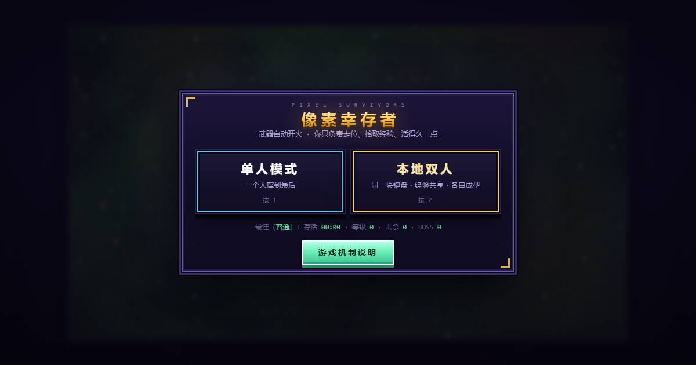

# Pixel Survivors · 像素幸存者

A **single-file** pixel-art horde-survival roguelite. Open the page and play — no install, no build step, no external dependencies. Double-clicking `index.html` just works.

**[▶ Play online](https://example.github.io/pixel-survivors/)** ← replace with your own URL after deploying



> The game's UI is in Chinese. This document covers everything you need to play it.

---

## Gameplay

Weapons **fire automatically**. Your only jobs are positioning, picking up XP, and staying alive. Every level is a pick-one-of-three upgrade, every 28 seconds brings an enemy wave, and every 5th wave spawns a boss. There is no ending — the goal is to survive longer, unlock heroes, and beat your per-difficulty records.

**21 weapons · 18 passives · 8 heroes · 6 maps · 5 difficulties · 14 enemy types · 6 bosses**

### Controls

| | Single player | Local co-op (2P) |
|---|---|---|
| Move | `WASD` / arrow keys, or hold the mouse button to walk toward the cursor | 1P = `WASD` (mouse also works) · 2P = arrow keys |
| Pause | `P` / `ESC` | `P` / `ESC` |
| Character stats panel | `TAB` | `TAB` (both players shown side by side) |
| Pick an upgrade | Click a card, or press `1` `2` `3` | Click a card, or press `1` `2` `3` (players pick in turn) |
| Restart (after death) | `R` | `R` |

Keys are read by **physical position** (`e.code`), so AZERTY, QWERTZ, Dvorak and Cyrillic layouts all use the same physical area — nothing gets scrambled.

### Mobile / tablet

**Press anywhere on the screen and drag** to move. A floating virtual stick appears under your finger; drag to steer, release to stop. The stick is analog — a gentle push walks slowly, pushing past about two-thirds of the radius is full speed.

- **Rotate your phone to landscape.** The game is 16:9 and doesn't fit in portrait (you'll get a prompt screen).
- Local co-op is **not available on touch** — it's a two-players-one-keyboard mode. Use a computer for that.
- Desktop browsers are completely unaffected; the touch code path never runs there.

### Local co-op

Two players, one keyboard.

- **Shared XP and level** — gems count for the team no matter who picks them up
- **Separate weapons and passives** — on level-up the two players pick one card each, in turn; the card header says whose turn it is
- **Shared camera** — 480×270 can't fit a split screen, so the camera locks to the midpoint of the two players. Nobody gets left behind; the trade-off is that you can't split up for long
- **Going down isn't the end** — at zero HP you're *downed*, and a teammate standing next to you for 2.2 s revives you at 40% HP. Bleed out for 18 s with nobody helping and you're *out*; the other player keeps going. The run only ends when both are down
- **Aggro is per-player** — enemies, homing bullets and XP gems each independently target whoever is closest

---

## Playing it

### Option 1: download it

Download `index.html` and double-click it. That's the whole thing.

Same for sharing — it's one file, so WeChat / QQ / email all work. **No internet connection required.**

### Option 2: GitHub Pages

1. Push the repo to GitHub
2. Repo → **Settings** → **Pages**
3. **Source**: `Deploy from a branch`; **Branch**: `main` + `/ (root)`; save
4. Wait a minute or two. Your URL is `https://<username>.github.io/<repo>/`

A `.nojekyll` file is included to disable GitHub Pages' Jekyll processing.

> **The link preview image is already wired up.** The two `og:image` tags in `index.html`'s `<head>` point at `cover.png` in this repo, served from `raw.githubusercontent.com`. Two things to watch: it must be an **absolute URL** (social platforms won't resolve relative paths), and it must point at the **image itself** — GitHub's `/blob/` page URL returns HTML and gets fetched as a broken image.
>
> To serve it from GitHub Pages instead (`https://suzhiboy.github.io/Pixel-Survivors/cover.png`), enable Pages and swap the domain in both tags.

### Option 3: itch.io

1. New project → Kind of project: **HTML**
2. Zip `index.html` (and `cover.png`) with **`index.html` at the archive root**
3. Tick "This file will be played in the browser"

itch.io embeds games in an iframe, so the player must **click the canvas once** to give it keyboard focus. That's itch's behaviour, not the game's.

### Option 4: any static host

Cloudflare Pages, Netlify, Vercel, plain nginx — drop it in. No build step, no server-side logic.

---

## Compatibility

Zero external dependencies is the main advantage here: no CDN, no web fonts, no image requests, no `fetch`. Every asset — icons and sound effects included — is inlined or generated at runtime. It works **fully offline**.

| Environment | Status |
|---|---|
| Chrome / Edge 108+ | ✅ Primary development and test environment |
| Firefox 101+ | ✅ Static analysis clean, not tested on a real device |
| Safari 15.4+ / iOS Safari | ✅ Static analysis clean, not tested on a real device |
| Android Chrome | ✅ Static analysis clean, not tested on a real device |
| `file://` (local double-click) | ✅ |
| Inside an iframe (itch.io) | ✅ needs a click first to gain focus |

Only three features have a meaningful version floor: `100dvh` (Chrome 108 / Safari 15.4 / Firefox 101), `env(safe-area-inset-*)` (notch padding), and `backdrop-filter` (shipped with the `-webkit-` prefix). Older browsers degrade but don't break.

Saves use `localStorage`, with every read and write wrapped in `try/catch` — private browsing or blocked third-party storage just means progress isn't saved. The game still plays.

---

## Project layout

```
.
├── index.html      ← the entire game, in one file
├── cover.png       ← link preview image (og:image)
├── shots/          ← README screenshots
├── LICENSE
└── .nojekyll
```

Inside `index.html`: a `<style>` block (~540 lines of CSS), the HTML skeleton (panels / HUD / canvas), then one `<script>` (~5000 lines inside an IIFE, organised into 21 sections).

**There is no build step.** Edit and refresh — that's the whole workflow. It's a single file on purpose: under `file://`, `<script type="module">` is blocked by CORS, so splitting it up would break local double-click play.

The internal render resolution is fixed at 480×270; the canvas scales by an **integer multiple of physical pixels** (computed from `devicePixelRatio`), so the pixel art never gets half-pixel seams on any display.

---

## License

[MIT](LICENSE) — use it, change it, republish it.
