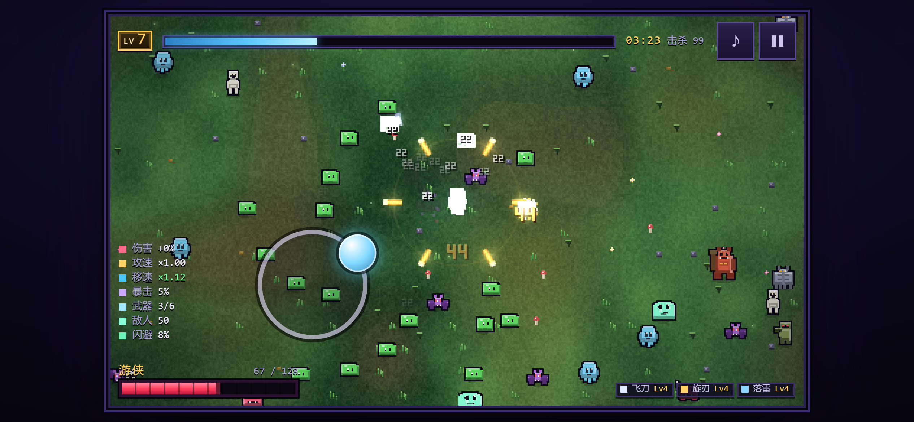
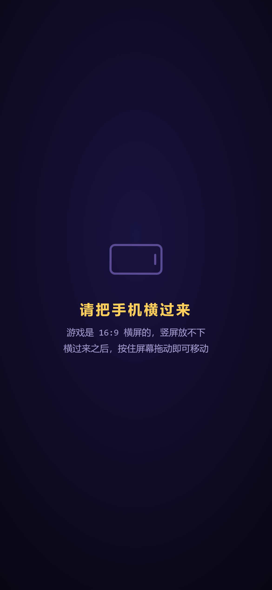
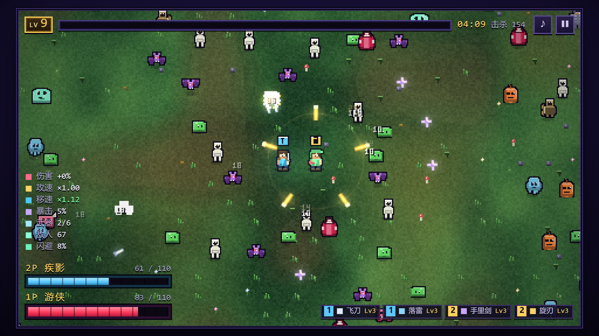

# 像素幸存者 · Pixel Survivors

一个**单文件**的像素风幸存者类（roguelite / horde survival）游戏。打开网页就能玩，不用安装、不用构建、没有任何外部依赖 —— `index.html` 双击就能跑。

**[▶ 在线试玩](https://example.github.io/pixel-survivors/)** （网页版开发中）


---

## 玩法

武器**全自动开火**，你只负责走位、拾取经验、活得久一点。每升一级三选一强化，每 28 秒来一波敌潮，每 5 波出一只 BOSS。没有通关终点，目标是活得更久、解锁角色、刷新各难度的纪录。

**21 种武器 · 20 种被动 · 8 个角色 · 6 张地图 · 5 档难度 · 14 种敌人 · 6 只 BOSS**

### 操作

| | 单人模式 | 本地双人 |
|---|---|---|
| 移动 | `WASD` / `方向键`，或按住鼠标朝指针走 | 1P = `WASD`（也可按住鼠标）· 2P = `方向键` |
| 暂停 | `P` / `ESC` | `P` / `ESC` |
| 角色数据面板 | `TAB` | `TAB`（两人数据并排显示） |
| 选择升级 | 点卡片，或 `1` `2` `3` | 点卡片，或 `1` `2` `3`（两人轮流各选一张） |
| 重开（死亡后） | `R` | `R` |

键位按**物理位置**识别（走 `e.code`），所以 AZERTY / QWERTZ / Dvorak / 俄语键盘上按的还是同一片区域，不会错位。

### 手机 / 平板

**按住屏幕任意位置拖动**即可移动 —— 手指按下的地方会浮出一个虚拟摇杆，往哪拖就往哪走，松手即停。摇杆带力度：轻轻推走得更慢，推过半径约三分之二就是满速。

- 请**把手机横过来**：游戏是 16:9 的，竖屏放不下（会显示提示页）
- 触屏上**不提供本地双人** —— 那是两个人共用一块键盘的玩法，想双人请用电脑
- 桌面浏览器完全不受影响，多出来的这套触屏逻辑不会改变任何手感

<p align="center">
  
  
</p>

### 本地双人

同一块键盘上两个人一起打。

- **经验与等级共享**：宝石谁捡都算团队的，等级一起涨
- **武器和被动各长各的**：升级时两人轮流各选一张，卡面标题会写明轮到谁
- **镜头共用**：480×270 塞不下分屏，所以镜头锁在两人中点上，谁也不会被落下 —— 代价是不能长时间分头行动
- **倒下不等于结束**：生命归零先进入**倒地**状态，队友贴身 2.2 秒可以扶起来（回到 40% 生命）；倒地超过 18 秒没人来扶就**出局**，剩下那个人继续打。两人都倒下这局才结束
- **仇恨各算各的**：敌人追谁、敌弹锁谁、宝石飞向谁，都按"谁近找谁"独立结算

<p align="center"></p>

---

## 怎么玩到它

### 方式一：直接下载（最简单）

下载 `index.html`，双击。就这一件事。

发给朋友也一样 —— 一个文件，微信 / QQ / 邮件都能发。对方双击就能玩，**不需要联网**。

### 方式二：GitHub Pages

1. 把仓库推上 GitHub
2. 仓库页 → **Settings** → 左侧 **Pages**
3. **Source** 选 `Deploy from a branch`，**Branch** 选 `main` + `/ (root)`，保存
4. 等一两分钟，地址是 `https://<你的用户名>.github.io/<仓库名>/`

仓库里有一个 `.nojekyll` 空文件，用来关掉 GitHub Pages 的 Jekyll 处理 —— 省得它自作主张地改文件。

> **链接预览图已经配好了。** `index.html` 头部的两条 `og:image` 指向 `raw.githubusercontent.com` 上本仓库的 `cover.png`。这里有两个坑：必须是**完整网址**（社交平台不解析相对路径），而且必须指向**图片本身** —— GitHub 网页上那个 `/blob/` 链接返回的是 HTML，抓下来会当成坏图。
>
> 想改走 GitHub Pages 的话（`https://suzhiboy.github.io/Pixel-Survivors/cover.png`），开启 Pages 后把两处域名换掉即可。国内分享到微信 / QQ 如果预览图不显示，可以换成 jsDelivr：`https://cdn.jsdelivr.net/gh/suzhiboy/Pixel-Survivors@main/cover.png`（在国内有节点）。

### 方式三：itch.io

1. 新建项目，Kind of project 选 **HTML**
2. 把 `index.html`（和 `cover.png`）压成一个 zip，**`index.html` 必须在压缩包根目录**
3. 勾选 "This file will be played in the browser"

itch.io 是用 iframe 嵌的，玩家需要**先点一下画面**键盘才有焦点 —— 这是 itch 的机制，不是游戏的问题。

### 方式四：任何静态托管

Cloudflare Pages、Netlify、Vercel、Gitee Pages、自己的 nginx…… 扔上去就行。没有构建步骤，没有服务端逻辑。

---

## 兼容性

零外部依赖是这里最大的优势：没有 CDN、没有网络字体、没有图片请求、没有 `fetch`。全部资源（包括图标和音效）都是内联的或程序化生成的。所以**离线也能玩**，托管方的域名被墙了也照样跑。

| 环境 | 状态 |
|---|---|
| Chrome / Edge 108+ | ✅ 主要开发与测试环境 |
| Firefox 101+ | ✅ 静态检查通过，未实机测试 |
| Safari 15.4+ / iOS Safari | ✅ 静态检查通过，未实机测试 |
| 安卓 Chrome | ✅ 静态检查通过，未实机测试 |
| `file://` 本地双击 | ✅ |
| iframe 内嵌（itch.io） | ✅ 需要先点击获取焦点 |

用到的、有版本门槛的特性只有三个：`100dvh`（Chrome 108 / Safari 15.4 / Firefox 101）、`env(safe-area-inset-*)`（刘海屏留白）、`backdrop-filter`（带 `-webkit-` 前缀）。更老的浏览器会退化，但不会崩。

存档用 `localStorage`，读写都包在 `try/catch` 里 —— 隐私模式、iframe 里禁用第三方存储，都只是存不上，不影响玩。

---

## 项目结构

```
.
├── index.html      ← 游戏本体。全部内容都在这一个文件里
├── cover.png       ← 链接预览图（og:image）
├── shots/          ← README 配图
├── LICENSE
└── .nojekyll
```

`index.html` 里依次是：`<style>`（约 540 行 CSS）、HTML 骨架（面板 / HUD / 画布）、一个 `<script>`（约 5000 行，用 IIFE 包着，分 21 个小节）。

**没有构建步骤。** 改完直接刷新浏览器就是最新版。这也是为什么它是单文件：`file://` 协议下 `<script type="module">` 会被 CORS 拦掉，拆成多文件在本地双击就跑不起来了。

---

## 开发

没有依赖，没有 npm，没有打包器。想改就直接改 `index.html`。

内部渲染分辨率固定 480×270，画布按**物理像素的整数倍**放大（先算 `devicePixelRatio` 再取整），所以像素画在任何屏幕上都不会有半像素毛边。

游戏状态集中在一个 `G` 对象里，玩家是 `G.players` 数组（单人长度 1，双人长度 2），所有系统都按下标取人。

---

## 许可

[MIT](LICENSE) —— 随便用、随便改、随便再发布。
